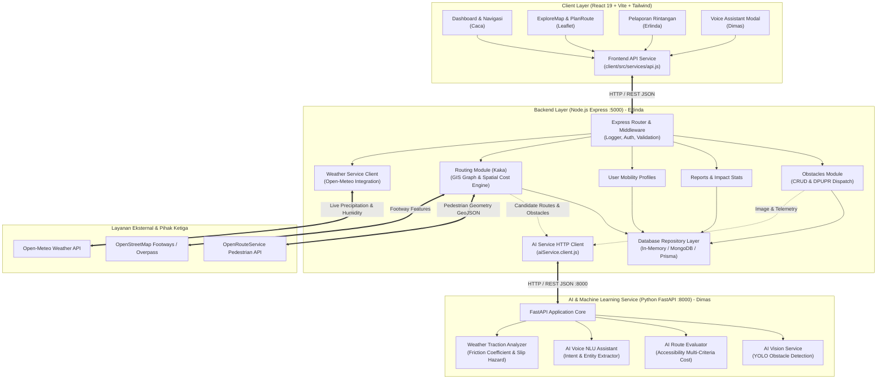
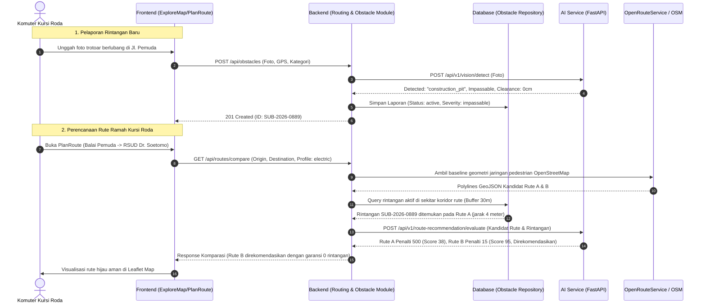

# LELUASA — System Architecture & Integration Blueprint

Dokumen arsitektur ini menjelaskan interaksi antarkomponen dalam platform navigasi aksesibilitas **LELUASA**, mencakup alur komunikasi antara Frontend (React), Backend (Node.js Express), Layanan AI (Python FastAPI), serta mesin routing OpenStreetMap / OpenRouteService.

---

## 1. Diagram Arsitektur Sistem (System Architecture)

---

## 2. Alur Komunikasi Antar-Layanan (Service Communication Flow)

### A. Frontend ➔ Backend ➔ AI Service
1. **Frontend (`client`)**: Pengguna berinteraksi melalui antarmuka web modern (dashboard, peta navigasi, atau modal suara). Semua request HTTP keluar diarahkan ke URL backend `/api/...` melalui `client/src/services/api.js`.
2. **Backend (`server`)**: Bertindak sebagai *orchestrator*, gerbang keamanan, dan pengelola data persistensi. Backend memvalidasi request, mengelola sesi, membaca/menulis ke database, dan meneruskan tugas inferensi komputasi berat ke `ai-service`.
3. **AI Service (`ai-service`)**: Berjalan secara terisolasi pada Python FastAPI di port `8000`. Layanan ini murni stateless dan fokus pada inferensi model Machine Learning (YOLO untuk penglihatan komputer, NLU berbasis aturan/transformer untuk suara, serta pemodelan gesekan trotoar).

---

## 3. Integrasi Mesin Routing & Propagasi Laporan Rintangan

Salah satu pilar terpenting dalam platform **LELUASA** adalah bagaimana rintangan fisik yang dilaporkan warga secara dinamis memengaruhi perhitungan rute kursi roda:

---

## 4. Standar Penalti Aksesibilitas Kursi Roda

Berbeda dengan navigasi pejalan kaki umum, mesin evaluasi Leluasa mengacu pada **Permen PUPR No. 14/2017 tentang Persyaratan Kemudahan Bangunan Gedung dan Lingkungan**:

1. **Jarak Bebas Bersih (*Clearance Width*)**:
   - $\ge 120\text{ cm}$: Ideal untuk berselisihan 2 kursi roda.
   - $80 - 119\text{ cm}$: Dapat dilewati 1 kursi roda standar.
   - $< 80\text{ cm}$: Diklasifikasikan sebagai *impassable* (penalti maksimal 500 poin).
2. **Kelandaian Rampa (*Ramp Slope*)**:
   - $\le 6\%$ ($1:16$): Sangat aman dan landai.
   - $6\% - 8\%$ ($1:12$): Batas maksimum rampa standar.
   - $> 8\%$: Berbahaya dan diberi penalti elevasi tinggi.
3. **Kondisi Permukaan Jalan (*Surface Friction Index*)**:
   - Permukaan keramik dekoratif saat hujan diidentifikasi memiliki risiko slip tinggi ($\text{COF} < 0.35$), sehingga dialihkan ke koridor berkanopi atau cor semen bertekstur.

