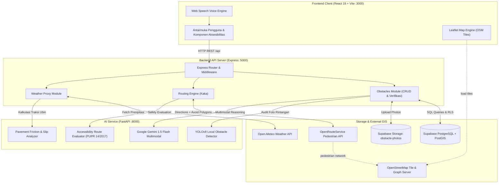

# LELUASA — Inclusive Sidewalk Navigation & Mobility System

> **Platform Navigasi Trotoar Aksesibel & Ramah Kursi Roda Berbasis AI Vision, Routing OpenStreetMap, dan Partisipasi Komunitas.**

[](https://instagram.com/logicodix)
[](#2-tema-dan-relevansi)
[](#5-teknologi-yang-digunakan)
[](#14-lisensi)

---

### Informasi Submission Hackathon

| Komponen | Keterangan |
|---|---|
| **Nama Tim** | **digendong mamat** |
| **Institusi** | Institut Teknologi Sepuluh Nopember (ITS) |
| **Kategori Lomba** | Web Application (Minimum Viable Product / MVP) |
| **Subtema** | **4. Inclusive Health & Well-being** *(dengan irisan ke Subtema 5: Civic Tech)* |
| **Repositori GitHub** | [https://github.com/dimasptrr/logicodix_leluasa](https://github.com/dimasptrr/logicodix_leluasa) |
| **Tautan Aplikasi (Deploy)** | [https://leluasa.vercel.app](https://logicodix-leluasa.vercel.app/) *(dan dapat dijalankan lokal di `http://localhost:3000`)* |
| **Video Demonstrasi (YouTube)** | [Tautan Video Demo Resmi LELUASA (3–5 Menit)](https://youtu.be/leluasa-demo-logicodix2026) |

---

## Anggota Tim & Matriks Tanggung Jawab

| Nama Anggota | Peran Utama | Akun GitHub | Cakupan Modul & Tanggung Jawab |
|:---:|---|---|---|
| **Dimas Muhammad Putra** | **AI & Machine Learning Lead** | [@dimasptrr](https://github.com/dimasptrr) | • Arsitektur Microservice AI (`ai-service/` FastAPI :8000)<br>• Deteksi rintangan trotoar lokal via **YOLOv8** & bobot `yolov8n.pt`<br>• Audit multimodal trotoar & estimasi *clearance* via **Google Gemini 1.5 Flash**<br>• Asisten suara (*Voice Assistant NLU*) & *Weather Traction Analysis* |
| **Erlinda Annisa** | **Fullstack & Backend Lead** | [@Erlinda20](https://github.com/Erlinda20) | • REST API Server Express (`server/` :5000)<br>• Database **Supabase PostgreSQL + PostGIS** & storage foto rintangan<br>• CRUD Laporan Rintangan warga, sistem *upvote*, dan disposisi DPUPR<br>• Integrasi proxy jembatan client-server-AI |
| **Maritza Adelia Sucipto** | **UI/UX & Frontend Lead** | [@maritzaadeliaa](https://github.com/maritzaadelia076) | • Antarmuka Pengguna React 19 + Tailwind CSS (`client/` :3000)<br>• Aksesibilitas antarmuka (mode kontras tinggi, navigasi ramah screen reader, shortcut suara `'V'`)<br>• Visualisasi peta interaktif Leaflet, modal interaktif, dan kartu laporan |
| **I Gede Bagus Saka Sinatrya** | **Routing Engine & GIS Lead** | [@SakaSinatrya](https://github.com/SakaSinatrya) | • Jaringan pedestrian OpenStreetMap (OSM) & **OpenRouteService (ORS)**<br>• Algoritma *Dynamic Obstacle Avoidance* (spatial buffer polygon 25m)<br>• Konversi geometri GeoJSON ↔ Leaflet & *Accessibility Cost Engine* berstandar **Permen PUPR No. 14/PRT/M/2017** |

---

## 1. Latar Belakang dan Rumusan Masalah

Aksesibilitas ruang publik pejalan kaki di Indonesia masih menjadi tantangan kritis bagi penyandang disabilitas motorik, khususnya pengguna kursi roda manual maupun elektrik. Trotoar perkotaan sering kali dipenuhi oleh rintangan fisik mikro yang tidak terduga:
1. **Palang Pembatas (Bollard) Terlalu Sempit:** Jarak bersih antar-bollard sering kali < 60 cm (di bawah standar minimal kursi roda 80–90 cm).
2. **Ketiadaan Rampa Trotoar (Curb Ramps):** Undakan trotoar setinggi > 15–20 cm tanpa bidang miring landai, membuat pengguna kursi roda terjebak dan terpaksa turun ke badan jalan raya yang padat kendaraan bermotor.
3. **Pekerjaan Proyek Utilitas & Galian Terbuka:** Pipa air, kabel bawah tanah, atau lubang drainase tanpa jembatan penyeberangan sementara.
4. **Paving Rusak, Amblas, & Licin:** Ubin pemandu (*guiding blocks*) yang terputus atau licin saat basah tergenang hujan.

### Mengapa Aplikasi Peta Umum (Google Maps / Waze) Belum Menjawab Masalah Ini?
Aplikasi navigasi komersial dirancang terutama untuk kendaraan bermotor atau pejalan kaki tanpa disabilitas fisik:
* **Mengabaikan Hambatan Fisik Mikro:** Google Maps hanya menghitung jarak Euclidean/jalan raya terpendek tanpa mengetahui apakah trotoar di jalan tersebut memiliki tangga, galian, atau bollard sempit.
* **Mengarahkan ke Jalur Buntu Mematikan (*Dead-End*):** Rute jalan kaki sepanjang 300 meter yang disarankan peta biasa bisa menjadi jalan buntu yang mustahil dilewati kursi roda, memaksa pengguna berputar arah ratusan meter atau membahayakan nyawa dengan melintas di jalur mobil/truk.
* **Ketiadaan Informasi Aksesibilitas Real-Time:** Peta umum tidak memetakan derajat kelandaian (*slope incline*), lebar efektif jalur, maupun kondisi traksi ubin trotoar saat hujan.

### Konteks Wilayah Surabaya
Surabaya memiliki jalur pedestrian aktif di koridor pusat kota (seperti koridor **Balai Pemuda, Jl. Gubernur Suryo, Jl. Pemuda, Jl. Walikota Mustajab, hingga RSUD Dr. Soetomo**). Kendati infrastruktur trotoar telah dibangun rapi oleh pemerintah kota, pemasangan bollard anti-sepeda motor yang terlalu rapat dan pekerjaan galian saluran drainase sering kali memutus kontinuitas akses kursi roda. **LELUASA** hadir untuk menjembatani kesenjangan mobilitas ini secara cerdas, kolaboratif, dan inklusif.

### Dasar Kebijakan & Landasan Regulasi
Inovasi LELUASA berlandaskan pada standar hukum dan pedoman teknis resmi:
* **Permen PUPR No. 14/PRT/M/2017** tentang *Persyaratan Kemudahan Bangunan Gedung dan Fasilitas Pejalan Kaki* (Standar rampa maksimal 6%–8%, lebar bersih trotoar minimal 80–120 cm).
* **Peraturan Pemerintah (PP) No. 42 Tahun 2020** tentang *Aksesibilitas terhadap Permukiman, Pelayanan Publik, dan Pelindungan dari Bencana bagi Penyandang Disabilitas*.
* **Surat Edaran Dirjen Bina Marga No. 07/P/BM/2023** tentang *Pedoman Perencanaan Teknis Fasilitas Pejalan Kaki*.
* Kebijakan penataan dan pengawasan fasilitas pedestrian Pemerintah Kota Surabaya (Dinas Perhubungan & DPUPR Kota Surabaya).

---

## 2. Tema dan Relevansi

LELUASA berkompetisi pada **Subtema 4: Inclusive Health & Well-being**:
> *"Merancang solusi berbasis teknologi yang meningkatkan aksesibilitas informasi kesehatan, memantau kesejahteraan mental, atau membantu penyandang disabilitas dalam kehidupan sehari-hari."*

* **Relevansi Utama (Inclusive Mobility & Health):**
  Mobilitas mandiri (*independent mobility*) adalah hak asasi dan prasyarat dasar bagi penyandang disabilitas untuk dapat mengakses fasilitas layanan kesehatan (seperti rumah sakit dan puskesmas), pusat rehabilitasi, tempat pendidikan, dan lapangan kerja. Rute trotoar yang aman mengurangi risiko kecelakaan fatal dan kelelahan fisik ekstrem bagi pengguna kursi roda.
* **Nilai Tambah Sinergis (Subtema 5: Civic Tech & Community Service):**
  LELUASA mengadopsi mekanisme *civic reporting* berbasis partisipasi warga (*crowdsourced urban reporting*). Setiap warga dapat memotret dan melaporkan rintangan trotoar. Data ini teragregasi secara otomatis dan siap diekspor menjadi laporan disposisi resmi untuk Dinas Pekerjaan Umum dan Penataan Ruang (DPUPR) Kota Surabaya.

---

## 3. Solusi dan Target Pengguna

### Solusi yang Ditawarkan
LELUASA adalah ekosistem navigasi pedestrian cerdas dan inklusif yang mengintegrasikan:
1. **Peta Partisipatif Hambatan Trotoar (*Barrier Map*):** Visualisasi sebaran rintangan fisik trotoar aktif di Surabaya dengan indikator tingkat keparahan (*impassable*, *difficult*, *caution*), foto bukti lapangan, dan koordinat GPS presisi.
2. **Mesin Perutean Aksesibel Dinamis (*Accessible Routing Engine*):** Mengomparasikan Rute Standar pejalan kaki vs Rute Rekomendasi Leluasa yang otomatis memutar menghindari poligon rintangan via OpenRouteService (ORS) dan graf pejalan kaki OpenStreetMap (OSM).
3. **HUD Panduan Navigasi & Peringatan Zona 10 Meter (*Haptic & Audio Alarm*):** Panduan navigasi belokan demi belokan (*turn-by-turn HUD*) dengan alarm suara otomatis dan simulasi getaran haptik (*Web Vibration API*) ketika pengguna berada dalam radius 10 meter dari rintangan berbahaya.
4. **Inspeksi AI Hybrid (*Computer Vision & Multimodal Reasoning*):** Model lokal YOLOv8 mendeteksi bounding box objek fisik secara instan (< 150 ms), diperkuat oleh Google Gemini 1.5 Flash untuk estimasi sisa celah trotoar (*clearance width in cm*) dan saran keselamatan berstandar Permen PUPR No. 14/2017.
5. **Asisten Navigasi Suara Cerdas "LUMI" (*Hands-Free Wake Word & NLU*):** Pengguna dapat mengoperasikan aplikasi tanpa menyentuh layar menggunakan *wake word* latar belakang **"Hai LUMI"** / **"Halo LUMI"** atau shortcut keyboard `'V'`, dengan pemahaman maksud percakapan berbasis Gemini NLU.
6. **Intelijen Cuaca & Traksi Ubin (*Weather & Traction Intelligence*):** Menghitung koefisien gesek ubin pemandu (*pavement friction index*) secara dinamis menggunakan telemetri curah hujan Open-Meteo, serta otomatis menambahkan *rain safety buffer minutes* pada estimasi waktu tempuh.
7. **Gamifikasi & Insentif Warga (*Civic Transit Rewards*):** Warga pelapor dan pemverifikasi trotoar memperoleh poin kontributor yang dapat ditukarkan langsung dengan tiket transportasi umum ramah disabilitas Kota Surabaya (**Feeder WiraWiri Suroboyo** dan **Suroboyo Bus** berarmada *low-floor* rampa lipat).
8. **Portal Transparansi Perbaikan DPUPR (*Before & After Impact Tracking*):** Pelacakan status perbaikan infrastruktur oleh Dinas Pekerjaan Umum dan Penataan Ruang (DPUPR) Kota Surabaya dengan galeri komparasi foto Sebelum vs Sesudah perbaikan.

### Profil Target Pengguna
* **Pengguna Kursi Roda Mandiri:** Pengguna kursi roda manual maupun elektrik yang memerlukan kepastian trotoar datar, keberadaan rampa landai, dan bebas dari undakan tinggi atau galian terbuka.
* **Pendamping Disabilitas & Lansia (*Caregivers*):** Pendamping yang mendorong kursi roda atau kereta bayi (*stroller*) dan membutuhkan rute dengan kelandaian aman (< 6%–8%).
* **Warga Peduli Aksesibilitas (Relawan Komunitas):** Masyarakat umum yang berkontribusi memotret, memvalidasi, dan mengawasi fasilitas pejalan kaki kota melalui insentif tiket transportasi.
* **Pemerintah Kota & Instansi Terkait (DPUPR & Dishub Surabaya):** Pemangku kebijakan yang menerima rekap spasial audit trotoar siap tindak lanjut untuk pemeliharaan fasilitas pedestrian.

---

## 4. Fitur Utama & Status Implementasi

Seluruh fitur di bawah ini **telah diimplementasikan penuh dan dapat diuji secara langsung** pada prototipe aplikasi:

| Modul / Fitur | Deskripsi Fungsionalitas | Status | Penanggung Jawab |
|---|---|:---:|---|
| **Barrier Map (Peta Hambatan Navigasi)** | Peta interaktif Leaflet menampilkan sebaran rintangan trotoar Surabaya secara real-time, filter keparahan (*impassable*, *difficult*, *caution*), dan drawer inspeksi detail. | **Berjalan Penuh** | Caca & Erlinda |
| **Accessible Route Comparison** | Komparasi berdampingan **Rute A (Standar)** vs **Rute B (Leluasa)** dari titik awal ke destinasi, jarak, durasi, dan daftar instruksi belokan. | **Berjalan Penuh** | Kaka |
| **Turn-by-Turn HUD & Peringatan 10m** | Mode panduan navigasi aktif dengan kartu HUD arah belokan, sintesis suara panduan jalan, dan modal peringatan rintangan otomatis + getaran haptik zona 10 meter. | **Berjalan Penuh** | Caca & Kaka |
| **Dynamic Obstacle Avoidance** | Algoritma pembentukan zona poligon pembatas spasial (*avoid_polygons* buffer ~25 meter) di sekeliling titik rintangan aktif sehingga graf rute kursi roda otomatis memutar mencari rampa aman. | **Berjalan Penuh** | Kaka |
| **Community Obstacle Reporting** | Formulir pelaporan ramah warga dengan 2 mode pilihan: *Sedang di Lokasi* (auto-GPS) dan *Tidak di Lokasi* (pencarian alamat/pin peta), unggah foto kamera/galeri, dan estimasi celah. | **Berjalan Penuh** | Erlinda & Caca |
| **AI Vision Detector (Hybrid YOLO + Gemini)** | Analisis foto trotoar ganda: inferensi bounding box fisik instan via **YOLOv8** lokal (< 150 ms) dan audit kontekstual trotoar via **Google Gemini 1.5 Flash** (clearance cm & advisory). | **Berjalan Penuh** | Dimas |
| **Asisten Suara "LUMI" (Wake Word & NLU)** | Asisten suara hands-free dengan deteksi kata pemicu latar belakang **"Hai LUMI"**, Web Audio chime, shortcut `'V'`, ekstraksi niat NLU (4 intent), dan navigasi otomatis antartab. | **Berjalan Penuh** | Dimas & Caca |
| **Weather & Traction Intelligence** | Analisis kondisi cuaca Surabaya real-time via **Open-Meteo API**: menghitung indeks gesek ubin (*traction friction*), batas kecepatan ban kursi roda, dan penyesuaian waktu hujan (+mnt). | **Berjalan Penuh** | Dimas & Erlinda |
| **Gamifikasi & Reward Tiket Bus Warga** | Saldo poin kontributor warga, badge tingkat keterlibatan (*Level 4 Kontributor Emas*), dan katalog penukaran tiket **Feeder WiraWiri** (100 poin) & **Suroboyo Bus All-Day** (150 poin). | **Berjalan Penuh** | Caca & Erlinda |
| **Portal Riwayat Komunitas & DPUPR** | Rekap status disposisi perbaikan trotoar dengan showcase komparasi foto *Sebelum vs Sesudah* (*Before & After*) pengerjaan teknis oleh DPUPR Kota Surabaya. | **Berjalan Penuh** | Erlinda & Caca |
| **Verifikasi Komunitas (Crowd-Upvote)** | Pengguna lain dapat mengonfirmasi kondisi rintangan (*"Masih Ada"* vs *"Sudah Diperbaiki"*). Status laporan otomatis bertransisi menjadi *Resolved* jika telah terverifikasi. | **Berjalan Penuh** | Erlinda |
| **Geocoding & Reverse Geocoding** | Pencarian nama tempat/alamat dan snapping koordinat trotoar menggunakan ekosistem **Photon Komoot** dan **OSM Nominatim** dengan opsi putar balik rute (*Swap Direction* ⇅). | **Berjalan Penuh** | Kaka |

### Struktur 7 Menu Navigasi Utama Aplikasi
Aplikasi LELUASA memiliki arsitektur navigasi yang bersih dan konsisten yang dapat diakses melalui bilah navigasi atas (*Header*) maupun laci navigasi samping (*Sidebar*):
1. **Dashboard (`home`):** Pusat kendali rute cepat, pencarian multi-stop, visualisasi kartografi taktil Surabaya, telemetri cuaca mikro, dan ringkasan status perjalanan aktif.
2. **Peta Navigasi (`explore-map`):** Peta interaktif Leaflet layar penuh untuk menjelajahi sebaran rintangan trotoar, melihat foto bukti lapangan, serta melakukan upvote verifikasi warga.
3. **Rute & Perbandingan (`plan-route`):** Kalkulator komparasi rute pejalan kaki standar vs rute kursi roda ramah aksesibilitas, visualisasi 2 garis rute (merah vs hijau-cyan), estimasi cuaca, dan tombol aktivasi panduan navigasi langkah demi langkah.
4. **Lapor Hambatan (`report-obstacle`):** Formulir partisipasi publik untuk melaporkan rintangan trotoar dengan pemindaian AI Vision instan, opsi GPS otomatis atau pin manual, dan reward poin kontributor.
5. **Riwayat Komunitas (`reports-impact`):** Portal transparansi sipil yang menampilkan linimasa laporan warga, statistik penanganan trotoar, dan galeri perbaikan infrastruktur oleh DPUPR Surabaya (foto Sebelum vs Sesudah).
6. **Intelijen Cuaca (`weather-intelligence`):** Pusat telemetri cuaca cerdas Surabaya berbasis Open-Meteo, mencakup indeks kelicinan ubin pemandu, risiko selip ban, batas kecepatan aman berkendara, dan rekomendasi jalur alternatif beratap.
7. **Profil & Reward Warga (`profile`):** Halaman profil kontributor sipil, pelacakan saldo poin reward, status lencana pahlawan trotoar, dan katalog voucher tiket transportasi umum ramah disabilitas (WiraWiri Suroboyo & Suroboyo Bus).

---

## 5. Teknologi yang Digunakan

```
[ Frontend: React 19 + Vite 8 + Tailwind CSS + Leaflet 1.9 ]
                            │
                      REST API (JSON)
                            ▼
[ Backend: Node.js 22 + Express 4.21 + PostGIS Proxy ]
      │                     │                     │
      ▼                     ▼                     ▼
[ Supabase PostgreSQL ]  [ OpenRouteService ]  [ Open-Meteo API ]
(PostGIS Spasial + Auth)   (Wheelchair Graph)   (Presipitasi Cuaca)
                            ▲
                     HTTP REST Proxy
                            ▼
[ AI Service: Python 3.13 + FastAPI 0.110 ]
   ├── Local CV: Ultralytics YOLOv8 (yolov8n.pt)
   └── Cloud LLM: Google Gemini 1.5 Flash Multimodal
```

| Lapisan Sistem | Teknologi / Pustaka | Versi | Fungsi Utama dalam Proyek |
|---|---|:---:|---|
| **Frontend Framework** | **React** | `19.3.1` | Pembangunan antarmuka reaktif berbasis komponen modular |
| **Build Tool & Bundler** | **Vite** | `8.3.5` | Lingkungan pengembang cepat, Hot Module Replacement (HMR), dan optimasi build |
| **Styling & Design System**| **Tailwind CSS** | `3.4.19` | Sistem desain berbasis Material 3 dengan utilitas aksesibilitas tinggi |
| **Peta Interaktif Web** | **Leaflet** | `1.9.4` | Rendering peta vektor, custom markers animasi, polylines rute, dan kontrol interaktif |
| **Backend Framework** | **Node.js + Express** | `Node 22 / Express 4.21.2` | REST API Gateway, orkestrasi integrasi antar-layanan, dan kontrol bisnis |
| **Basis Data Spasial** | **Supabase (PostgreSQL + PostGIS)** | `v15+` | Tabel spasial `geography(point, 4326)` dengan indeks GiST, Row Level Security, dan storage |
| **Mesin Perutean Spasial** | **OpenRouteService (ORS API v2)** | `v2.0` | Kalkulasi rute pedestrian riil (`foot-walking` & `wheelchair`) berbasis graf trotoar OSM |
| **Penyedia Peta & Data** | **OpenStreetMap (OSM)** | `2026 Live` | Tile peta visual gratis dan jaringan jalur pejalan kaki global |
| **Geocoding & Alamat** | **Photon Komoot & OSM Nominatim** | `API Publik` | Pencarian alamat dan konversi nama lokasi Surabaya ke koordinat GPS |
| **Layanan AI Microservice**| **Python + FastAPI** | `Python 3.13 / FastAPI 0.110` | Endpoint pemrosesan Computer Vision, kalkulasi traksi cuaca, dan evaluasi rute |
| **Computer Vision Lokal** | **Ultralytics YOLOv8** | `8.2.0+` | Model deteksi objek fisik rintangan trotoar secara lokal dengan latensi rendah |
| **Multimodal LLM Reasoning**| **Google Gemini 1.5 Flash** | `API v1beta` | Audit kontekstual gambar trotoar, estimasi sisa celah bersih (*clearance cm*), dan asisten suara |
| **Data Cuaca Real-Time** | **Open-Meteo API** | `Live REST` | Prakiraan presipitasi curah hujan, suhu, dan kelembapan koridor Surabaya |

---

## 6. Arsitektur Sistem dan Alur Data

### Diagram Arsitektur Keseluruhan


### Penjelasan Alur Data (*Data Flow*)

#### 1. Alur Pelaporan Rintangan & Deteksi AI (*Obstacle Reporting Flow*)
1. Pengguna/relawan membuka tab **"Lapor Rintangan"** dan mengunggah foto hambatan trotoar beserta koordinat GPS otomatis (atau klik di peta).
2. Frontend mengirim *payload* ke backend Express `POST /api/obstacles`.
3. Backend memanggil layanan AI (`ai-service` :8000) secara *hybrid*:
   * **YOLOv8**: Mendeteksi bounding box objek fisik (bollard, galian, undakan, kendaraan parkir liar) secara cepat.
   * **Gemini 1.5 Flash**: Melakukan audit mendalam untuk mengestimasi sisa lebar lajur (*clearance width in cm*) dan menghasilkan rekomendasi navigasi ramah disabilitas.
4. Data rintangan, hasil AI, dan tautan foto disimpan ke tabel **Supabase PostGIS** (`obstacle_reports`).
5. Marker rintangan baru langsung muncul secara *real-time* di **Barrier Map** untuk dilihat seluruh pengguna.

#### 2. Alur Perbandingan Rute Aksesibel (*Accessible Route Comparison Flow*)
1. Pengguna membuka tab **"Plan Route"** dan memilih profil kursi roda (Listrik / Manual / Skuter / Pendamping).
2. Pengguna menentukan titik awal (contoh: *Balai Kota Surabaya*) dan tujuan (contoh: *Grand City Surabaya*).
3. Backend menerima request `GET /api/routes/compare`:
   * Backend mengambil daftar rintangan aktif berkategori *impassable* di koridor perjalanan dari database.
   * Algoritma GIS Kaka membentuk zona poligon pembatas (*avoid_polygons* ~25 meter) di sekeliling titik rintangan.
   * Backend memanggil OpenRouteService untuk menghasilkan **Rute A (Pejalan Kaki Biasa)** dan **Rute B (Kursi Roda dengan Poligon Hindaran)**.
4. Cost Engine menghitung *Safety Score* (0–100) berdasarkan ada/tidaknya rintangan dan kelandaian rampa trotoar sesuai standar Permen PUPR No. 14/2017.
5. Frontend Leaflet me-render dua garis rute sekaligus:
   * **Garis Merah Putus-putus**: Rute Standar (memotong galian / tidak aksesibel).
   * **Garis Hijau-Cyan Solid**: Rute AI Leluasa (memutar aman via jalur bertrotoar lebar).

#### 3. Alur Intelijen Cuaca & Traksi Ubin (*Weather & Traction Flow*)
1. Modul cuaca mengambil data presipitasi curah hujan, suhu, dan kelembapan saat ini di Surabaya dari **Open-Meteo API**.
2. Modul `traction_service.py` menghitung koefisien gesek ubin pemandu (*guiding tiles friction index*) berdasarkan material trotoar (keramik, paving, beton, aspal).
3. Jika terdeteksi curah hujan > 1 mm atau kelembapan tinggi, sistem mengalkulasi *rain safety buffer* (+2 hingga +5 menit) pada rute dan menyajikan peringatan batas kecepatan aman:
   > **Peringatan:** *"Ubin pemandu licin akibat hujan. Koefisien gesek turun ke level Waspada (45/100). Harap kurangi kecepatan kursi roda elektrik ke maks 4 km/jam."*

#### 4. Alur Asisten Suara Interaktif "LUMI" (*Voice Assistant & NLU Flow*)
1. Pengguna memanggil asisten dengan *wake word* latar belakang **"Hai LUMI"** / **"Halo LUMI"**, menekan shortcut keyboard `'V'`, atau mengeklik ikon mikrofon.
2. Web Speech API mengonversi ucapan suara menjadi teks Bahasa Indonesia.
3. Teks dikirim ke endpoint `POST /api/v1/voice-assistant/chat` di microservice AI:
   * **Google Gemini 1.5 Flash** (didukung fallback regex) memetakan teks ke salah satu dari 5 *intent*: `NAVIGATE_TO`, `REPORT_OBSTACLE`, `CHECK_WEATHER`, `TOGGLE_ACCESSIBILITY`, atau `GENERAL_CHAT`.
   * Sistem mengekstrak entitas tujuan (misal: *"RSUD Dr. Soetomo"*) dan menghasilkan balasan verbal yang ringkas, empatik, dan solutif.
4. Frontend mengeksekusi instruksi: otomatis berpindah ke tab tujuan (`suggested_tab`), memicu pencarian rute, dan membacakan balasan suara menggunakan *SpeechSynthesis*.

#### 5. Alur Panduan Navigasi Belokan Demi Belokan & Alarm Zona 10m (*Active Navigation & Haptic HUD Flow*)
1. Dari halaman perbandingan rute, pengguna menekan tombol **"Mulai Panduan Navigasi"**.
2. Antarmuka bertransisi ke mode navigasi aktif: menampilkan kartu HUD arah belokan (*turn instruction*), panah navigasi besar, jarak belokan berikutnya, dan pembacaan suara langkah perjalanan (*Audio Wayfinding*).
3. Posisi GPS dipantau terhadap koordinat titik rintangan aktif di sepanjang rute perjalanan.
4. Ketika jarak pengguna mendekati **<= 10 meter** dari rintangan trotoar berstatus *impassable* atau *difficult*, sistem otomatis memicu:
   * **Banner / Modal Peringatan Bahaya:** Menampilkan jenis rintangan dan jarak sisa.
   * **Peringatan Suara LUMI:** *"Perhatian! 10 meter di depan terdapat rintangan trotoar. Harap melambat atau bersiap memutar."*
   * **Getaran Haptik Perangkat:** Pola getaran taktil (*Web Vibration API pattern: `[200, 100, 200, 100, 300]`*) untuk memperingatkan pengguna tunarungu atau kondisi jalan bising.

#### 6. Alur Gamifikasi & Insentif Tiket Warga (*Civic Rewards & DPUPR Flow*)
1. Setiap laporan rintangan trotoar yang dikirimkan warga otomatis memberikan **+100 Poin Kontribusi**, dan setiap konfirmasi verifikasi komunitas memberikan **+25 Poin**.
2. Poin terakumulasi secara real-time pada profil warga dengan tingkatan kontributor (*Level 4 Kontributor Emas — Pahlawan Trotoar Surabaya*).
3. Warga dapat menukarkan saldo poin dengan voucher tiket transportasi umum Kota Surabaya yang terverifikasi ramah kursi roda:
   * **Tiket Feeder WiraWiri Suroboyo (100 Poin):** Armada *low-floor* dengan rampa aksesibel kursi roda.
   * **Tiket Suroboyo Bus All-Day Pass (150 Poin):** Tiket terusan 1 hari penuh ramah disabilitas.
4. Seluruh laporan warga diagregasikan ke modul disposisi DPUPR dan disajikan secara transparan di tab **Riwayat Komunitas** lengkap dengan komparasi foto Sebelum vs Sesudah perbaikan fisik.

---

## 7. Panduan Instalasi dan Menjalankan Aplikasi

### Prasyarat Perangkat Lunak
* **Node.js**: Versi `>= 18.0.0` (Direkomendasikan Node.js v20 atau v22 LTS)
* **npm**: Versi `>= 9.0.0`
* **Python**: Versi `>= 3.10` (Direkomendasikan Python 3.11 atau 3.13)
* **Git**: Terpasang di sistem operasi

---

### Langkah 1: Kloning Repositori
Buka terminal dan unduh kode sumber proyek:
```bash
git clone https://github.com/dimasptrr/logicodix_leluasa.git
cd logicodix_leluasa
```

---

### Langkah 2: Konfigurasi Variabel Lingkungan (`.env`)
Salin file template lingkungan di direktori utama:
```bash
# Untuk Windows (Command Prompt):
copy .env.example .env

# Untuk Linux / macOS / PowerShell:
cp .env.example .env
```
Buka file `.env` dan lengkapi variabel yang diperlukan (lihat rincian pada Bagian 8).  
*(Catatan: Aplikasi sudah dilengkapi mock dan fallback cerdas sehingga tetap dapat dijalankan penuh secara lokal sekalipun tanpa kunci API eksternal).*

---

### Langkah 3: Instalasi Dependensi Seluruh Layanan

#### A. Dependensi Backend Express:
```bash
npm --prefix server install
```

#### B. Dependensi Frontend Vite React:
```bash
npm --prefix client install
```

#### C. Dependensi AI Service (Python):
```bash
# Disarankan menggunakan virtual environment:
python -m venv .venv

# Aktivasi virtual environment:
# Windows (PowerShell):
.venv\Scripts\Activate.ps1
# Windows (CMD):
.venv\Scripts\activate.bat
# Linux / macOS:
source .venv/bin/activate

# Install pustaka Python:
pip install -r ai-service/requirements.txt
```

---

### Langkah 4: Menjalankan Aplikasi

Buka **3 jendela terminal terpisah** di direktori root `logicodix_leluasa`:

#### **Terminal 1 — Backend Express Server (Port 5000):**
```bash
npm run server
```
*Server aktif di: `http://localhost:5000` (Health check: `http://localhost:5000/api/health`)*

#### **Terminal 2 — Frontend Client Vite (Port 3000):**
```bash
npm run client
```
*Aplikasi web aktif di: **`http://localhost:3000`***

#### **Terminal 3 — Microservice AI FastAPI (Port 8000):**
```bash
npm run ai
# Atau:
python -m uvicorn app.main:app --app-dir ai-service --reload --port 8000
```
*Dokumentasi Swagger API AI aktif di: **`http://localhost:8000/docs`***

---

### Langkah 5: Penyiapan Basis Data (Opsional / Supabase)
Jika ingin menghubungkan ke proyek Supabase pribadi:
1. Buat proyek baru di [Supabase](https://supabase.com).
2. Buka menu **SQL Editor** pada dashboard Supabase Anda.
3. Jalankan seluruh script SQL yang ada di file:  
   [`supabase/migrations/20261109121000_obstacle_reporting.sql`](supabase/migrations/20261109121000_obstacle_reporting.sql).
4. Salin URL proyek dan Service Role Key ke file `.env`.  
*(Jika tidak menggunakan Supabase, server Express LELUASA memiliki mekanisme in-memory fallback otomatis yang tetap menyimpan dan menyajikan data rintangan secara lokal).*

---

## 8. Variabel Lingkungan (.env)

Seluruh konfigurasi kredensial disimpan melalui environment variable. File `.env` **wajib masuk ke `.gitignore`** dan tidak boleh di-commit ke repositori publik.

| Variabel | Lingkup | Wajib? | Nilai Bawaan / Contoh | Deskripsi |
|---|:---:|:---:|---|---|
| `PORT` | Backend | Tidak | `5000` | Port listening untuk backend Express |
| `NODE_ENV` | Backend | Tidak | `development` | Mode lingkungan (`development` / `production`) |
| `CORS_ORIGIN` | Backend | Ya | `http://localhost:3000,http://localhost:5173` | Daftar origin frontend yang diizinkan mengakses REST API |
| `ORS_API_KEY` | Backend | Ya | `eyJvcmciOi...` *(Token ORS)* | API Key OpenRouteService untuk graf perutean kursi roda |
| `AI_SERVICE_URL` | Backend | Ya | `http://localhost:8000` | Alamat jaringan microservice AI FastAPI |
| `AI_SERVICE_TIMEOUT_MS`| Backend | Tidak | `8000` | Batas waktu timeout pemanggilan ke AI service (ms) |
| `SUPABASE_URL` | Backend | Opsional| `https://xyz.supabase.co` | URL endpoint REST Supabase |
| `SUPABASE_SERVICE_ROLE_KEY` | Backend | Opsional| `eyJhbGci...` | Kunci otorisasi server-side Supabase (jangan pernah di frontend) |
| `VITE_API_BASE_URL` | Frontend | Ya | `http://localhost:5000/api` | Base URL API backend yang dihubungi oleh browser Vite |
| `VITE_MAP_DEFAULT_LAT` | Frontend | Tidak | `-7.2575` | Koordinat latitude titik tengah default peta (Surabaya) |
| `VITE_MAP_DEFAULT_LNG` | Frontend | Tidak | `112.7521` | Koordinat longitude titik tengah default peta (Surabaya) |
| `VITE_MAP_DEFAULT_ZOOM`| Frontend | Tidak | `14` | Tingkat zoom awal Leaflet |
| `GEMINI_API_KEY` | AI Service | Opsional| `AIzaSy...` | Kunci Google AI Studio untuk Gemini 1.5 Flash multimodal |
| `GEMINI_MODEL` | AI Service | Tidak | `gemini-1.5-flash` | Versi model multimodal yang digunakan |
| `YOLO_MODEL_PATH` | AI Service | Tidak | `app/models/weights/yolov8n.pt` | Jalur file bobot pre-trained YOLOv8 |
| `CONFIDENCE_THRESHOLD` | AI Service | Tidak | `0.30` | Batas minimal probabilitas deteksi rintangan YOLO |
| `IOU_THRESHOLD` | AI Service | Tidak | `0.45` | Batas Intersection over Union untuk Non-Maximum Suppression |

---

## 9. Dokumentasi Penggunaan Kecerdasan Buatan (AI)

Sesuai ketentuan integritas, transparansi ilmiah, dan etika kompetisi **LOGICODIX 2026**, berikut adalah rincian transparan mengenai pemanfaatan Kecerdasan Buatan (*Artificial Intelligence*) pada sistem LELUASA:

### Matriks Pemanfaatan Model & Layanan AI

| Modul / Fitur Aplikasi | Model / Layanan AI | Jenis & Bobot Model | Fungsi Utama, Masukan (Input), & Keluaran (Output) |
|---|---|---|---|
| **Deteksi Fisik Rintangan Trotoar** | **Ultralytics YOLOv8** | Model lokal (`yolov8n.pt` ~6.2 MB) | **Input:** Gambar trotoar (Base64/JPEG).<br>**Fungsi:** Menemukan koordinat bounding box objek fisik penghambat (bollard, galian, undakan, kendaraan parkir liar, lubang jalan) secara lokal berlatensi sangat rendah (< 150 ms).<br>**Output:** Bounding box normalisasi `[x_min, y_min, x_max, y_max]`, confidence score, dan kelas deteksi. |
| **Audit Multimodal Trotoar & Clearance** | **Google Gemini 1.5 Flash** | Cloud Multimodal Vision LLM | **Input:** Foto trotoar + Prompt audit standar Permen PUPR 14/2017.<br>**Fungsi:** Menganalisis konteks keseluruhan trotoar, mengestimasi sisa lebar lajur yang bisa dilalui kursi roda (*clearance width in cm*), menentukan tingkat keparahan (*impassable / difficult / caution*), dan memberikan advis keselamatan.<br>**Output:** JSON terstruktur berisi ringkasan audit, sisa celah cm, dan rekomendasi navigasi. |
| **Asisten Suara Interaktif "LUMI"** | **Gemini 1.5 Flash + NLU Rule Engine** | Pemrosesan Bahasa Alami (*NLU*) | **Input:** Transkripsi teks suara pengguna Bahasa Indonesia santai/formal.<br>**Fungsi:** Mengklasifikasikan maksud (*intent parsing*) ke dalam 5 kategori (`NAVIGATE_TO`, `REPORT_OBSTACLE`, `CHECK_WEATHER`, `TOGGLE_ACCESSIBILITY`, `GENERAL_CHAT`), mengekstrak entitas tujuan, dan menghasilkan balasan verbal empatik yang ramah pembaca layar.<br>**Output:** JSON intent, nama destinasi, suggested tab frontend, dan teks suara balasan. |
| **Prediksi Friksi Ubin & Licin Cuaca** | **Weather Traction Analyzer** | Heuristic Physics Formulation | **Input:** Data presipitasi curah hujan (mm), kode cuaca WMO, kelembapan, dan jenis permukaan ubin dari Open-Meteo API.<br>**Fungsi:** Menghitung koefisien gesek dinamis ubin (*pavement friction coefficient*), risiko slip ban kursi roda, batas kecepatan aman (km/jam), dan penyesuaian waktu hujan (*rain buffer minutes*).<br>**Output:** Skor traksi 0–100, level risiko (*critical/high/safe*), dan advis berkendara. |
| **Evaluasi Keamanan Rute Spasial** | **Accessibility Cost Engine** | Multi-Criteria Scoring Model | **Input:** Geometri rute OpenRouteService + daftar rintangan aktif di koridor perjalanan.<br>**Fungsi:** Mengalkulasi penalti rintangan dan kelandaian rampa trotoar untuk menentukan *Safety Score* (0–100) dan label kelayakan aksesibilitas rute sesuai Permen PUPR No. 14/2017.<br>**Output:** Safety Score 0–100, label kelayakan (*Sangat Aksesibel* vs *Tinggi Risiko*), dan rasionalisasi teknis. |
| **Asisten Penulisan Kode Pengembangan** | **AI Coding Assistants** | LLM Code Generation | Digunakan selama masa *Hacking Week* untuk akselerasi boilerplate skema Pydantic, refactoring CSS responsive, dan penulisan dokumentasi teknis. **Seluruh logika bisnis, algoritma routing, dan integrasi diuji serta dipertanggungjawabkan 100% oleh tim pengembang.** |

---

### Spesifikasi Microservice AI (`ai-service/` FastAPI :8000)

Layanan kecerdasan buatan diisolasi dalam microservice mandiri berbasis Python FastAPI yang menyajikan 4 endpoint REST API:

1. **`POST /api/v1/vision/detect` — Deteksi Rintangan Hybrid:**
   * Menerima payload foto trotoar (Base64 string).
   * Menjalankan inferensi YOLOv8 lokal terlebih dahulu untuk kecepatan.
   * Bila API key Gemini terkonfigurasi, sistem memanggil Gemini 1.5 Flash untuk memperkaya deteksi dengan estimasi lebar celah (*clearance cm*) dan rekomendasi audit.
   * Mengembalikan respons terpadu dengan latensi rata-rata 120–800 ms.

2. **`POST /api/v1/voice-assistant/chat` — Pemrosesan Bahasa Alami (NLU) LUMI:**
   * Menerima transkripsi teks suara pengguna (contoh: *"LUMI, carikan rute aman ke RSUD Dr Soetomo"*).
   * Mengekstrak 5 intent utama:
     - `NAVIGATE_TO`: Mencari rute perjalanan ke destinasi tertentu → otomatis mengarahkan ke tab `plan-route`.
     - `REPORT_OBSTACLE`: Melaporkan jalan rusak atau rintangan → otomatis mengarahkan ke tab `report-obstacle`.
     - `CHECK_WEATHER`: Mengecek kelicinan trotoar dan kondisi hujan → otomatis mengarahkan ke tab `weather-intelligence`.
     - `TOGGLE_ACCESSIBILITY`: Menyesuaikan preferensi kontras atau ukuran sentuh.
     - `GENERAL_CHAT`: Tanya jawab panduan mobilitas ramah disabilitas.
   * Mengembalikan teks balasan lisan yang ringkas (maksimal 2–3 kalimat) yang langsung disuarakan melalui Web Speech API.

3. **`POST /api/v1/weather-intelligence/analyze` — Analisis Traksi & Kelicinan:**
   * Menerima telemetri cuaca dan jenis material trotoar (`ceramic_tile`, `pavers`, `concrete`, `asphalt`).
   * Menghitung koefisien gesek: ubin keramik basah terdiskon hingga -0.35 saat curah hujan > 4 mm.
   * Menghasilkan batas kecepatan aman kursi roda elektrik (misal: 2.5 km/jam saat kondisi kritis).

4. **`POST /api/v1/route-recommendation/evaluate` — Evaluasi Rute Sesuai Standar PUPR:**
   * Menerima kandidat rute pejalan kaki beserta koordinat rintangan aktif di sekitarnya.
   * Menghitung penalti: setiap rintangan berkategori *impassable* memberi penalti -50 poin dan memicu label *Tinggi Risiko*.

---

### Transparansi, Koreksi Pengguna, dan Prinsip Human-in-the-Loop

1. **Bukan Keputusan Mutlak (*Human-in-the-Loop*):** Seluruh hasil deteksi AI (koordinat bounding box, nama rintangan, estimasi celah trotoar, dan tingkat keparahan) disajikan kepada pelapor sebagai *rekomendasi awal*. Pengguna memiliki hak dan kendali penuh untuk mengoreksi jenis rintangan, menggeser titik pin lokasi GPS, atau mengubah angka lebar celah sebelum laporan dikirim ke basis data publik.
2. **Skor Kepercayaan (*Confidence Score*):** Setiap inferensi AI menyertakan persentase kepercayaan yang dapat diverifikasi (misal: *Bollard Terlalu Rapat — 95% Confidence*).
3. **Mekanisme Fallback Multi-Tingkat (*Graceful Degradation*):** 
   * Jika sambungan internet terputus atau kuota token Gemini habis, sistem secara otomatis beralih ke deteksi model lokal YOLOv8 dan engine NLU berbasis pola ekspresi reguler (*regex*).
   * Jika microservice AI mati, backend Express dan frontend Vite memiliki dataset simulasi offline (`foot.json`, `wheelchair.json`, `wheelchair-avoid.json`) sehingga fitur navigasi inti **tidak pernah berhenti berfungsi**.

---

## 10. Etika, Privasi, dan Keamanan Digital

LELUASA menerapkan prinsip etika dan keamanan data digital sesuai rubrik penilaian kompetisi:

- [x] **Keamanan Kredensial:** Seluruh token rahasia (`ORS_API_KEY`, `SUPABASE_SERVICE_ROLE_KEY`, `JWT_SECRET`) disimpan dalam file `.env` yang terisolasi dan diabaikan oleh `.gitignore`. Tidak ada kredensial yang di-*hardcode* pada repositori publik.
- [x] **Prinsip Least Privilege & Server-Side Proxy:** Pemanggilan OpenRouteService dan Supabase Service Role hanya dilakukan melalui backend Express (`server/`), sehingga API key dan kuota tim terlindungi dari kebocoran di sisi peramban (*browser*).
- [x] **Pelindungan Privasi Pengguna:** Metadata foto sensitif (seperti data EXIF lokasi asal atau perangkat kamera) disaring sebelum data disimpan ke basis data publik.
- [x] **Validasi Input & Batas Ukuran Data:** Seluruh request API dan upload gambar divalidasi dengan batasan ukuran payload maksimum untuk mencegah serangan *Denial of Service (DoS)*.
- [x] **Verifikasi Komunitas Anti-Hoaks:** Laporan kondisi trotoar dilengkapi sistem konfirmasi komunitas (*still_there* vs *fixed*) untuk mencegah pelaporan palsu yang merugikan publik.
- [x] **Transparansi Sumber Terbuka:** Mengedepankan transparansi atribusi terhadap seluruh data publik OpenStreetMap dan model open-source yang digunakan.

---

## 11. Keterbatasan Aplikasi Saat Ini & Rencana Masa Depan

### Keterbatasan Prototipe (MVP):
1. **Kelengkapan Data Trotoar OpenStreetMap:** Kualitas rute kursi roda di beberapa gang kecil sangat bergantung pada kelengkapan tag trotoar (`sidewalk=*`, `kerb=*`) yang dipetakan komunitas OpenStreetMap di area tersebut.
2. **Estimasi Lebar Celah dari Kamera Monokular:** Penghitungan estimasi sisa celah bersih (*clearance cm*) dari foto dua dimensi bersifat pendekatan (*estimatif*), dan dapat dipengaruhi oleh sudut pengambilan gambar atau pencahayaan malam hari.
3. **Cakupan Laporan Komunitas:** Akurasi peta rintangan berbasis partisipasi warga berbanding lurus dengan keaktifan relawan di wilayah tersebut; trotoar yang belum memiliki laporan bukan berarti 100% bebas rintangan fisik.

### Rencana Pengembangan Pasca-Hackathon (*Future Roadmap*):
* **Integrasi Sensor IoT Kursi Roda:** Pemasangan modul sensor ultrasonik/LiDAR mini berbasis ESP32 pada kursi roda untuk memetakan kualitas kerataan trotoar dan rampa secara otomatis saat pengguna berkendara.
* **Integrasi Langsung ke Sistem Pengaduan Pemkot Surabaya:** Menyambungkan webhook API disposisi LELUASA langsung ke portal layanan aspirasi pemerintah kota (WBS / *Surabaya Single Window* / DPUPR).
* **Aplikasi Native Mobile (Flutter / React Native):** Menghadirkan aplikasi seluler dengan fitur getaran haptik (*haptic feedback*) untuk membantu pengguna tunanetra dan disabilitas ganda saat melintasi rampa trotoar.

---

## 12. Struktur Repositori

```text
logicodix_leluasa/
├── .env.example                               # Template variabel lingkungan multi-service
├── .gitignore                                 # Aturan pengabaian file sensitif & dependencies
├── LICENSE                                    # Lisensi sumber terbuka proyek (MIT License)
├── package.json                               # Runner script utama proyek (npm run dev/client/server/ai)
├── README.md                                  # Dokumentasi resmi proyek LOGICODIX 2026
├── vercel.json                                # Konfigurasi deployment terpadu Vercel (SPA + API)
│
├── api/                                       # ENTRYPOINT VERCEL SERVERLESS
│   └── index.js                               # Serverless Express proxy handler untuk Vercel
│
├── ai-service/                                # MICROSERVICE AI (Python / FastAPI :8000)
│   ├── requirements.txt                       # Dependensi pustaka Python AI
│   ├── .env.example                           # Konfigurasi AI service
│   ├── README.md                              # Panduan teknis modul AI Dimas
│   ├── app/
│   │   ├── main.py                            # FastAPI entry point & CORS configuration
│   │   ├── config.py                          # Environment variable loader
│   │   ├── api/                               # Routers API (/api/v1/vision, /voice, /route, /weather)
│   │   ├── models/weights/                    # Penyimpanan bobot model YOLOv8 (yolov8n.pt)
│   │   ├── schemas/                           # Pydantic data schemas request/response
│   │   └── services/                          # Logika bisnis: Vision, Voice, Route Eval, Weather
│   ├── datasets/                              # Panduan & metadata dataset rintangan
│   └── notebooks/                             # Riset eksperimen pelatihan YOLOv8
│
├── client/                                    # FRONTEND WEB APPLICATION (React 19 + Vite :3000)
│   ├── package.json                           # Dependensi frontend (React, Leaflet, Tailwind)
│   ├── vite.config.js                         # Konfigurasi Vite & reverse proxy backend /api
│   ├── tailwind.config.js                     # Konfigurasi tema warna Material 3 & utilitas aksesibilitas
│   ├── vercel.json                            # Konfigurasi deployment SPA di Vercel
│   └── src/
│       ├── App.jsx                            # Layout utama & pengatur navigasi tab
│       ├── main.jsx                           # React DOM root entry point
│       ├── components/                        # Header, Sidebar, MobileBottomNav, AccessibilityModal, VoiceAssistantModal
│       ├── pages/                             # 7 Halaman Utama Aplikasi:
│       │   ├── Dashboard.jsx                  # Hub Kontrol Rute, Multi-stop & Live Geocoding
│       │   ├── ExploreMap.jsx                 # Peta Navigasi, Sebaran Rintangan & Drawer Detail
│       │   ├── PlanRoute.jsx                  # Komparasi Rute A vs B, Safety Score & Turn-by-Turn HUD
│       │   ├── ReportObstacle.jsx             # Formulir Pelaporan Warga + AI Vision Hybrid
│       │   ├── ReportsImpact.jsx              # Riwayat Komunitas & Transparansi Perbaikan DPUPR
│       │   ├── WeatherIntelligence.jsx        # Telemetri Cuaca, Traksi Ubin & Batas Kecepatan
│       │   └── Profile.jsx                    # Profil Kontributor, Poin Reward & Tiket Bus Kota
│       ├── features/                          # Modul Fitur Modular:
│       │   ├── ai/                            # Jembatan inferensi AI Vision & NLU
│       │   ├── dashboard/                     # useWakeWord ("Hai LUMI") & haptik
│       │   ├── rewards/                       # rewardService (Poin & Katalog Tiket Bus)
│       │   └── routing/                       # costEngine (Kalkulasi Skor Standar PUPR)
│       └── services/api.js                    # Client HTTP REST API service
│
├── server/                                    # BACKEND API GATEWAY (Node.js / Express :5000)
│   ├── package.json                           # Dependensi backend (Express, CORS, Dotenv)
│   └── src/
│       ├── app.js                             # Express server entry point, middleware & mock fallbacks
│       ├── config/env.js                      # Loader variabel lingkungan root .env
│       └── modules/
│           ├── routing/                       # OpenRouteService integration, geometry & avoid polygons
│           ├── obstacles/                     # Controller CRUD laporan rintangan & Supabase proxy
│           └── integrations/                  # HTTP client jembatan ke ai-service
│
├── supabase/                                  # BASIS DATA & MIGRASI SPASIAL
│   └── migrations/
│       └── 20261109121000_obstacle_reporting.sql  # Skema PostGIS, tabel reports, verifikasi, & RLS
│
└── docs/                                      # DOKUMENTASI ARSITEKTUR & TIM
    ├── API_CONTRACT.md                        # Spesifikasi kontrak REST API antar-layanan
    ├── ARCHITECTURE.md                        # Desain arsitektur modular & diagram sistem
    ├── TEAM_DIVISION.md                       # Panduan pembagian tugas & sprint workflow
    └── samples/ors/                           # Sampel respons rute ORS (foot.json, wheelchair.json, dll.)
```

---

## 13. Atribusi dan Penghargaan Sumber Daya

Proyek LELUASA dibangun dengan memanfaatkan dan menghargai karya komunitas sumber terbuka (*open-source*):
* **OpenStreetMap (OSM):** Data peta vektor dunia © [Kontributor OpenStreetMap](https://www.openstreetmap.org/copyright), dilisensikan di bawah *Open Database License (ODbL)*.
* **OpenRouteService (ORS):** Layanan komputasi perutean pedestrian dan kursi roda oleh *Heidelberg Institute for Geoinformation Technology (HeiGIT)*.
* **Open-Meteo:** Penyedia prakiraan data cuaca dan presipitasi terbuka oleh [Open-Meteo.com](https://open-meteo.com) di bawah lisensi *CC BY 4.0*.
* **Ultralytics YOLOv8:** Kerangka kerja deteksi objek computer vision mutakhir oleh [Ultralytics](https://github.com/ultralytics/ultralytics) di bawah lisensi *AGPL-3.0*.
* **Google Gemini API:** Layanan model bahasa dan visi multimodal oleh [Google AI Studio](https://aistudio.google.com).
* **Leaflet.js:** Pustaka visualisasi peta ramah perangkat seluler oleh Vladimir Agafonkin di bawah lisensi *BSD-2-Clause*.
* **Google Fonts & Material Symbols:** Ikonografi antarmuka dan tipografi *Plus Jakarta Sans* & *Inter* di bawah lisensi *SIL Open Font License*.
* **Google Stitch:** Eksplorasi purwarupa tata letak visual antarmuka awal yang dikembangkan ulang menjadi komponen React interaktif oleh tim pengembang.

---

## 14. Lisensi

Seluruh kode sumber pada proyek **LELUASA** dilisensikan di bawah lisensi **[MIT License](LICENSE)**.  
Anda bebas menggunakan, memodifikasi, dan mendistribusikan kode ini untuk tujuan penelitian, kemanusiaan, dan pengembangan teknologi aksesibilitas inklusif.

```text
Copyright (c) 2026 Tim digendong mamat — LOGICODIX Hackathon 2026
(Dimas Muhammad Putra, Erlinda Annisa, Maritza Adelia Sucipto, I Gede Bagus Saka Sinatrya)
```
